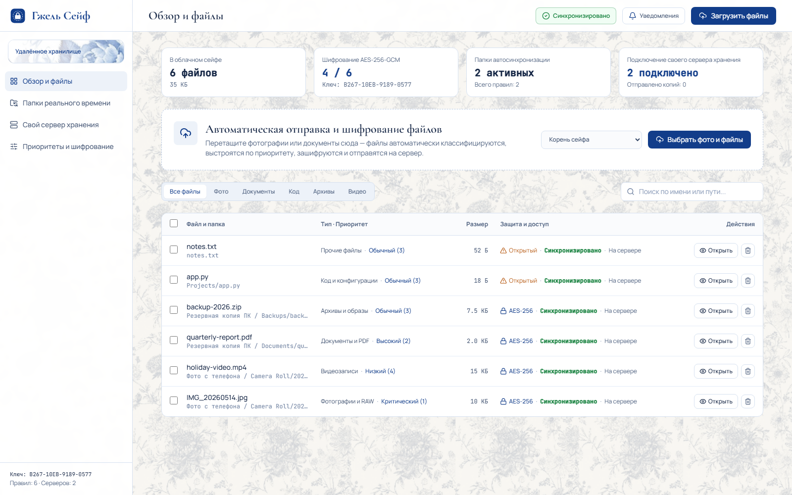
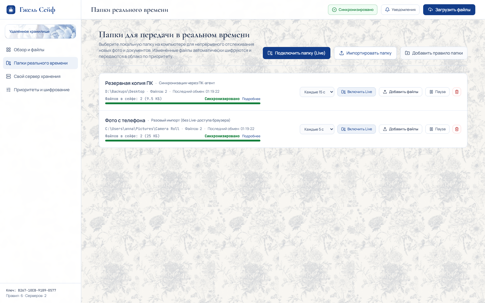
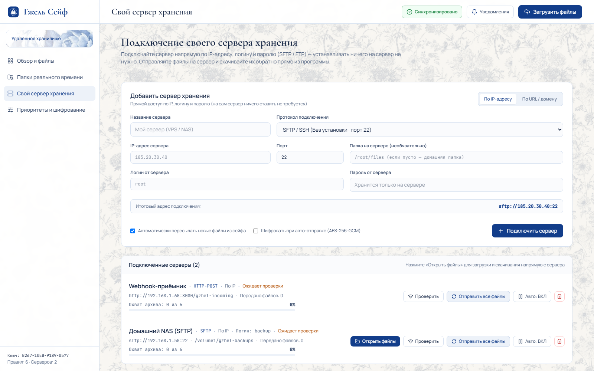
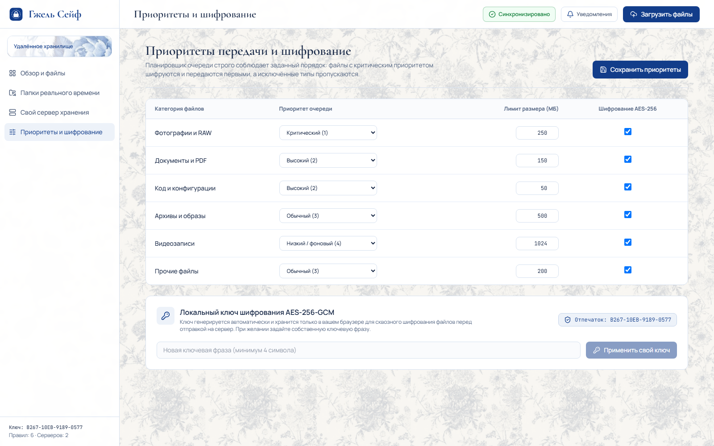
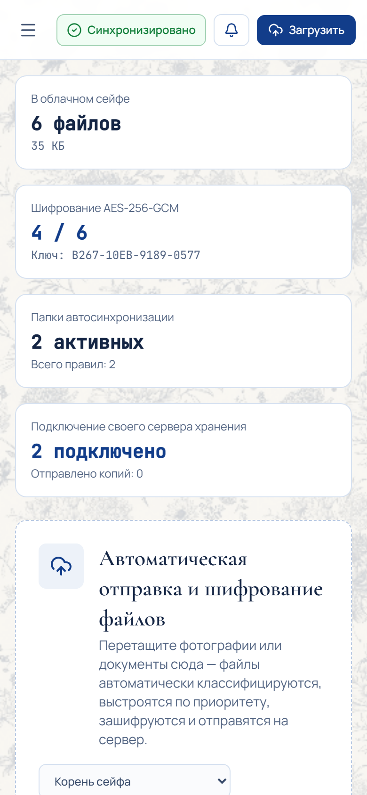

# Gzhel Safe (Гжель Сейф)

**Encrypted personal cloud vault** for Windows and Android. Photos and files are
automatically synced from your devices to **your own storage server** — no
third-party cloud. Everything is encrypted client-side with **AES-256-GCM**
before it ever leaves the device.

> This repository contains **only the release builds** (`.exe`, `.apk`),
> usage examples and screenshots. Source code is not published here.



---

## Downloads

| Platform | File | Version | Size | Notes |
|---|---|---|---|---|
| Windows 10/11 (x64) | [`Gzhel-Safe-Setup-1.0.0-x64.exe`](Gzhel-Safe-Setup-1.0.0-x64.exe) | 1.0.0 | ~119 MB | NSIS installer, per-user install |
| Android 7.0+ (API 24+) | [`gzhel-safe-1.0.0.apk`](gzhel-safe-1.0.0.apk) | 1.0.0 | see file | Signed release APK, sideload |

The same binaries are also attached to the
[**v1.0.0 release**](../../releases) of this repository.

> Windows may show a SmartScreen warning because the installer is not signed
> with a commercial certificate — click **More info → Run anyway**.
> On Android enable **Install unknown apps** for your file manager/browser
> to install the `.apk`.

---

## Features

- **AES-256-GCM client-side encryption** — the vault key never leaves the
  device (PBKDF2, 120 000 iterations); the server only stores ciphertext.
- **Real-time folder sync** — watch any local folder (File System Access API
  on desktop, PC agent on Windows) and new files are picked up automatically.
- **Priority engine** — route files by category (photo / document / video /
  archive / code / other) with priorities `critical → high → normal → low →
  exclude` and per-category size limits and auto-encryption.
- **Your own storage server** — forward the vault to a server you control via
  **SFTP / FTP / FTPS / WebDAV / S3 (MinIO) / HTTP POST-PUT**, or run the
  bundled receiver script (`gzhel-receiver-server.mjs`, downloadable from the
  app via *Servers → receiver script*) on any machine with Node.js.
- **PC agent** — a small downloadable Node agent (`gzhel-pc-agent.mjs`) pushes
  new files from a local folder to the vault instantly.
- **Cross-platform** — Windows desktop app (this `.exe`) and Android app
  (this `.apk`) share one vault through the same server.
- **PWA-style UI** — Gzhel porcelain design, works offline once loaded in a
  browser tab as well.

---

## Quick start

### 1. Windows (desktop app)

1. Download `Gzhel-Safe-Setup-1.0.0-x64.exe` and install (or run the installer
   and choose a folder).
2. Launch **Gzhel Safe**. The app starts its own local server and opens the
   vault UI. Data is stored in `%APPDATA%\Gzhel Safe\.vault-data`.
3. The app is reachable on your LAN at `http://<PC-IP>:<port>` (the port is
   picked automatically at start; check the app window title/logs or use the
   standard port when hosting the server yourself).

### 2. Android (APK)

1. Download `gzhel-safe-1.0.0.apk` to your phone and install it.
2. On first launch the app asks for the **server address** — enter the
   address of your Gzhel Safe server, e.g. `http://192.168.1.10:3000`
   (the Windows app on the same Wi-Fi, or any hosted instance).
3. Sign in to the same vault — your files, folders and servers appear.

See [`examples/QUICKSTART.md`](examples/QUICKSTART.md) for a detailed
walkthrough and [`examples/api-examples.md`](examples/api-examples.md) for
curl examples against the HTTP API.

---

## Screenshots

| | |
|---|---|
|  |  |
|  |  |
|  | |

---

## How it works

```
Phone (APK) ──┐                         ┌── SFTP/FTP/WebDAV/S3/HTTP ──> Your storage server
             ├─ AES-256-GCM ──> Gzhel Safe server (PC .exe or hosted) ─┤
PC    (EXE) ──┘   (ciphertext only at rest)                         └── receiver script / PC agent
```

- The **server** (`Gzhel Safe.exe` on Windows, or any Node.js host) stores the
  encrypted blobs and the vault index, and relays files to your storage
  servers.
- The **clients** (Windows app, Android app, browser tab) encrypt/decrypt
  locally and sync through the server's REST API (`/api/...`).

## Examples

- [`examples/QUICKSTART.md`](examples/QUICKSTART.md) — end-to-end setup guide
- [`examples/server-config.example.json`](examples/server-config.example.json) — example storage-server record
- [`examples/api-examples.md`](examples/api-examples.md) — curl examples: health, upload, list, priorities, add server
- [`examples/env.example`](examples/env.example) — environment variables for self-hosting

## Security notes

- Encryption: AES-256-GCM, key derived with PBKDF2-SHA-256 (120 000
  iterations, per-file random salt), random 96-bit IV per file.
- The vault passphrase/key is stored only in the client's IndexedDB
  (`gzhel-vault-local`); the server never sees it.
- Traffic to your own storage server uses the protocol you choose
  (prefer SFTP/FTPS/WebDAV-over-HTTPS/S3-over-HTTPS).

## License

[MIT](LICENSE)
